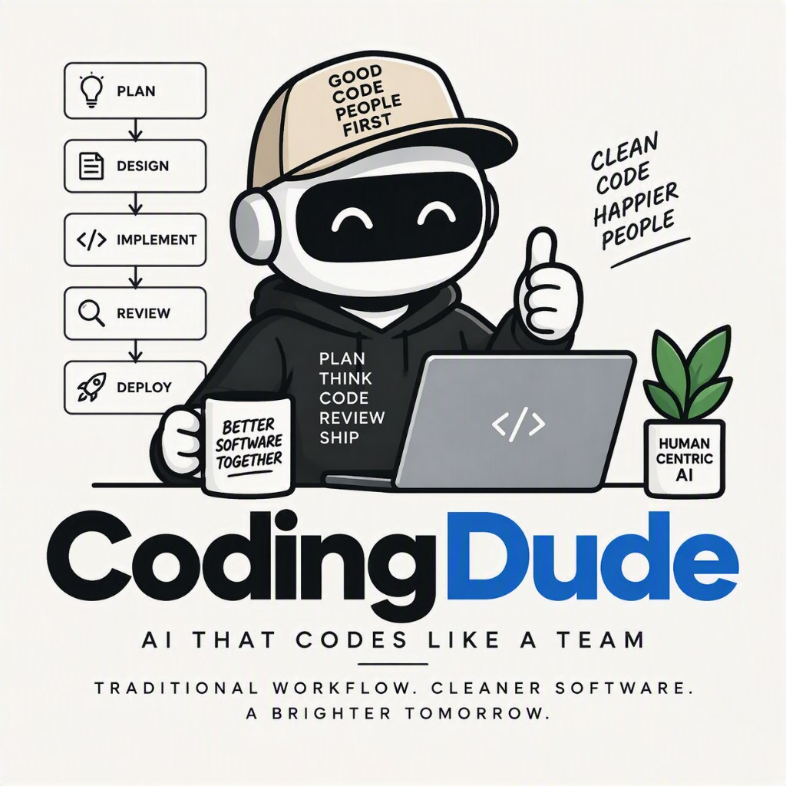

# CodingDude

Structured AI coding: a personal, single-user coding agent that plans,
designs, implements, reviews, and ships software-engineering work inside
your repository — built with [pydantic-ai](https://ai.pydantic.dev/),
driven from a web UI, with tiered approvals for risky actions.

Copyright (C) 2025 Cyberflex (https://www.cyberflex.io). Licensed under the
[GNU AGPL-3.0-or-later](LICENSE) — see [Licence](#licence).



## What it is

CodingDude applies structured AI coding to a real repository:
it reads and edits code, runs your gates (pytest/ruff/mypy, builds, tests),
plans non-trivial work, tracks it on a roadmap, and reports back with evidence
before claiming anything is done.

Highlights:

- **Agentic engine** — pydantic-ai with model failover (any OpenAI-compatible
  provider via `[providers.*]` config), per-run workers, session compaction,
  and a budget cap.
- **Tiered approvals** — safe actions run automatically; risky ones (pushes,
  installs, main-tree mutations) gate behind interactive cards in the UI.
  A `--yolo` headless mode bypasses gates for scripting.
- **File & code tools** — read/edit with AST-aware symbol rewrites, codegraph
  semantic navigation, project-wide impact analysis, arch lint, mutation
  testing, profiling, benchmarks, coverage.
- **Planning** — PRDs, tech designs, roadmap items, and tracer-bullet tickets
  with tracked plan steps, per-step evidence, and automatic post-push review.
- **Memory & continuity** — durable facts, solved-problem bank, project notes,
  ADR-style design decisions, and handover notes across sessions.
- **Delegation & sandboxes** — parallel sub-agents for reviews and research,
  plus worktree and container sandboxes for isolated experiments.
- **Skills** — a library of procedural skills (TDD, diagnosis, code review,
  StyleSeed design system, Ponytail audits, and more) loaded on demand via
  progressive disclosure.
- **Web UI** — React dashboard with per-run terminal, diff, trace, waterfall,
  cost, planning, artifacts, memory, MCP, and config tabs; SSE streaming;
  login-gated.
- **Extensible** — MCP client (codegraph, GitHub, vision servers), web
  search/fetch tools, and git/gh tooling with the same approval tiers.

See `docs/USER-MANUAL.md` for the full manual and
`docs/TECHNICAL-DESIGN-MANUAL.md` for the architecture.

## Run

```bash
uv run codingdude run "task"            # headless (exit 0 ok / 2 gate / 3 budget)
uv run codingdude serve                 # web UI on http://127.0.0.1:8765
```

## Setup

```bash
uv sync
export DEEPSEEK_API_KEY=...   # primary + subagent models
export ZAI_API_KEY=...        # failover model
```

## Layout

- `src/codingdude/` — engine, config, SQLite store, CLI
- `frontend/` — React web UI
- `tests/` — engine-seam tests (scripted FunctionModel runs against temp Workdirs)
- `.codingdude-seed/skills/` — skill library seeded into new projects
- `CONTEXT.md` — domain glossary
- `docs/` — manuals, ADRs, reference checklists

## Configuration

`~/.codingdude/config.toml` (created on first use; `CODEDUDE_HOME` overrides the directory):

| Key | Default |
|---|---|
| `models.main` | `deepseek:deepseek-v4-pro` |
| `models.subagent` | `deepseek:deepseek-v4-flash` |
| `models.fallback` | `zai:glm-5.3` |
| `models.fallback_base_url` | *(unset)* — set to `https://api.z.ai/api/coding/paas/v4` for GLM coding-plan keys |
| `shell.default` | `bash` (Git Bash) or `powershell` |

API keys come from the environment (`DEEPSEEK_API_KEY`, `ZAI_API_KEY`) or from
config.toml (env wins).

### Custom providers (#212)

Any OpenAI-compatible provider can be added — define a table and bind models
with `name:model`:

```toml
[providers.openrouter]
api_key = "…"
base_url = "https://openrouter.ai/api/v1"
# env_var = "OPENROUTER_API_KEY"   # optional; default <NAME>_API_KEY

[models]
main = "openrouter:anthropic/claude-sonnet-4"
```

A provider with a `base_url` routes every `name:model` binding to that
endpoint; without one, the built-in names (`zai`, `deepseek`, `openai`,
`anthropic`, `google`, `groq`, `mistral`, …) resolve via pydantic-ai. The
legacy shorthand (`[providers] zai = "key"`) still works. Providers are
managed in the Config tab (add/remove/edit + key test); the run composer's
model selector accepts any configured provider's models.

The same settings are editable in the UI's **Config** tab (`GET`/`PUT /config/models`).
The PUT is a **merge**, not a replacement: send only the fields you are changing;
send `null` to clear one. Omitted fields keep their stored value — so a partial
save can never wipe `fallback_base_url` (which silently moves z.ai onto the
standard API, where coding-plan keys are rejected). `GET` reports the lineup,
provider-key *presence* only (never values), and an advisory `warnings` list.

## Community and support

Questions, bug reports, and feature discussion happen on Discord:
**https://discord.gg/UA73mmfb**

- Setup / configuration problems — ask in the Discord. See
  `docs/COMMUNITY.md` for server channels and posting guidelines.
- Reproducible bugs — open an issue on
  [GitHub](https://github.com/cybersenses/codingdude/issues).
- Security issues — **do not** post publicly; follow `SECURITY.md`.

## Third-party notices

CodingDude builds on and adapts third-party work under permissive licences —
see [NOTICE.md](NOTICE.md) (pydantic-ai, github-mcp-server, and adapted skill
libraries from Matt Pocock, Ponytail, and StyleSeed).

## Licence

CodingDude is free software: you can redistribute it and/or modify it under
the terms of the [GNU Affero General Public License v3.0 or later](LICENSE).
If you run a modified version as a network service, you must offer its
source code to its users (AGPL §13). Private, internal use and modification
require no publication.

### Your code is yours

Code, documents, and other artifacts **generated by CodingDude for you
belong entirely to you**. CodingDude's authors make no claim to, and accept
no responsibility or warranty for, generated output. AGPL obligations apply
to CodingDude's own source code, not to what you build with it.

### Trademark

"Cyberflex", "CodingDude", and their logos are trademarks of Cyberflex
(https://www.cyberflex.io). The AGPL licence grants you the software, not
the names: if you redistribute a modified version, you must remove or
replace our trademarks (the Firefox/Iceweasel rule).

### Commercial licensing

AGPL permits commercial use, including reselling hosted instances — provided
you comply with its terms (notably network source disclosure). If AGPL terms
don't fit your use case (embedding in a closed product, redistribution
without source obligations), a commercial licence with an AGPL exemption is
available from Cyberflex (https://www.cyberflex.io). Contributions are
accepted under the CLA in `CLA.md`; see `CONTRIBUTING.md`.
